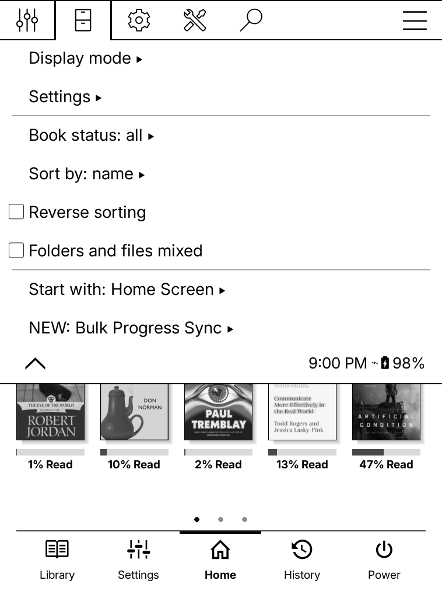
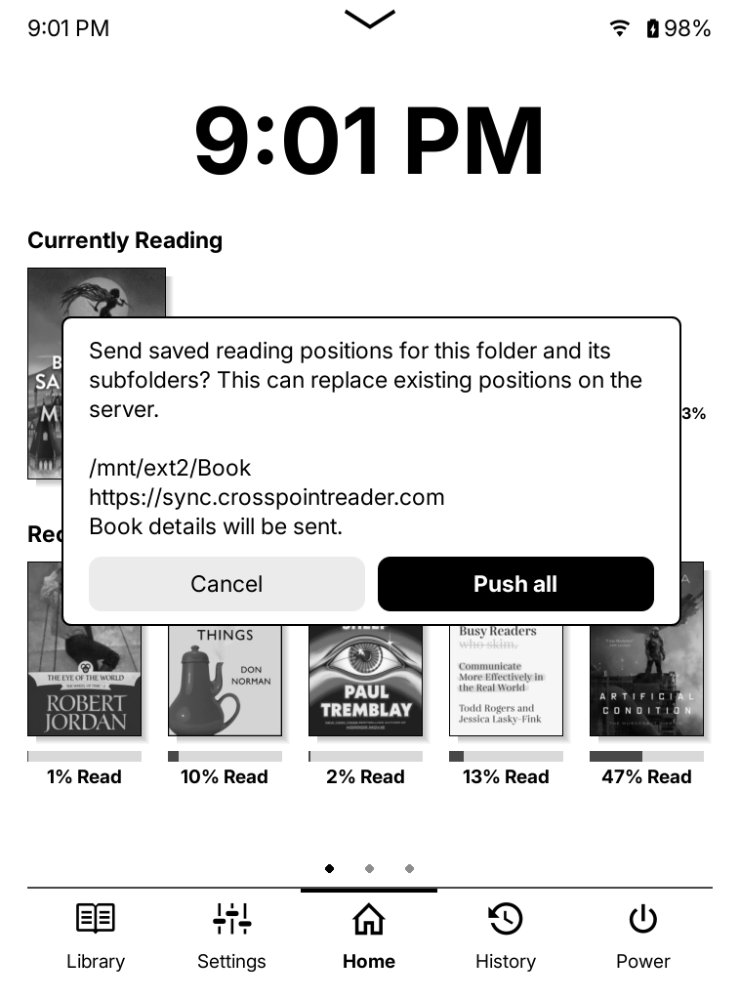
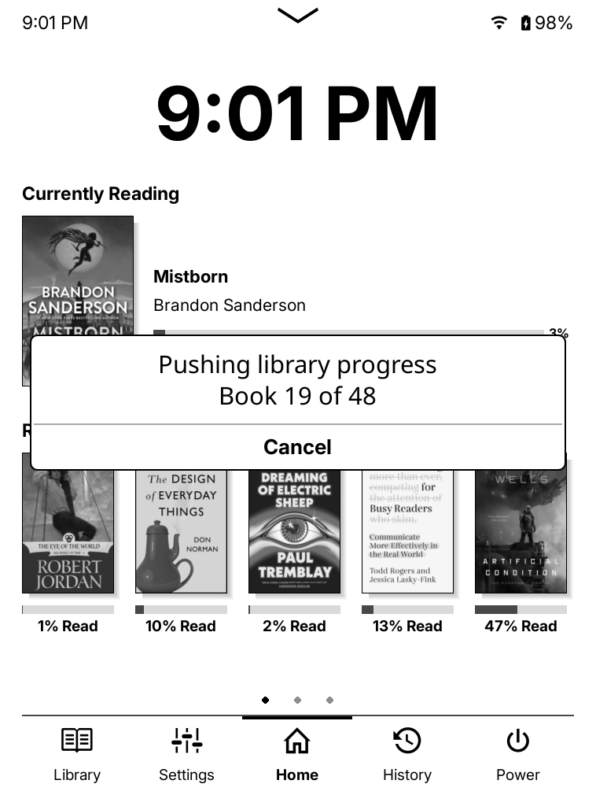
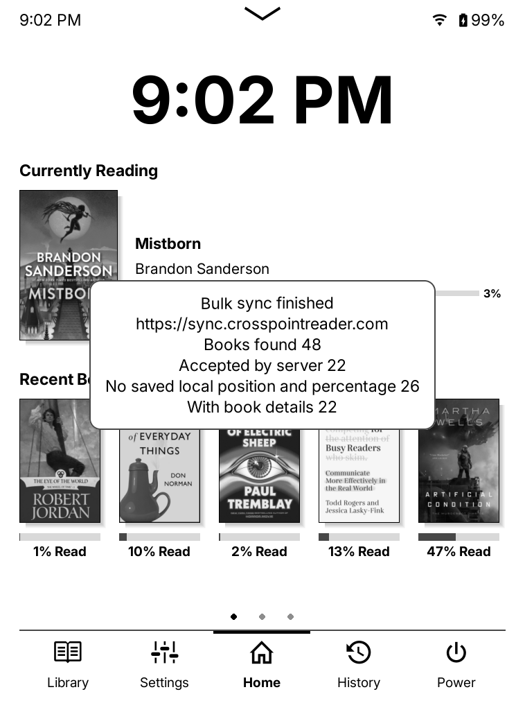

# Bulk Progress Sync

Sync saved reading positions for a books folder and its subfolders. Uses your existing **Progress sync** account and document matching setting. Custom sync servers should work.

Inspired by [MarMed/kobatchsync](https://github.com/MarMed/kobatchsync).

## 1. Install

KOReader must already be installed and working. **Progress sync** settings should already be configured.

1. Exit KOReader and connect your device to your computer, or use a file manager on Android.
2. Copy the extracted `bulkprogresssync.koplugin` folder into your device's plugin folder:

   | Device     | Plugin folder                                                                               |
   | ---------- | ------------------------------------------------------------------------------------------- |
   | PocketBook | `applications/koreader/plugins/`                                                            |
   | Kobo       | `.adds/koreader/plugins/` (enable hidden files to see `.adds`) or `.kobo/koreader/plugins/` |
   | Kindle     | `koreader/plugins/`                                                                         |
   | Android    | `Internal storage/koreader/plugins/` (create `plugins` if needed)                           |

3. If updating, move the old copy out of the plugin folder first.
4. Safely disconnect your device and restart KOReader. Open **Bulk Progress Sync** in the file browser menu.

**On Android**, start KOReader once before installing and allow storage access when asked. **Custom installations** may use another location; see KOReader's [plugin guide](https://koreader.rocks/user_guide/#L1-plugins).

## 2. Choose your books folder

1. Close any open book.
2. Open **Bulk Progress Sync → Choose library folder**.
3. Long-press your books folder to select it. To select the current folder, long-press **Long-press here to choose current folder**.
4. Select **Check library folder** to check the path and book count. This does not sync anything.

On PocketBook, **Choose SD card folder** is a shortcut to `/mnt/ext2`. On other devices, use **Choose library folder**. Choose a folder KOReader can access, such as `documents` on Kindle or `Books` on Android.

## 3. Sync

**Syncing can overwrite newer positions. Choose the source whose positions you want to keep.** Book files must already be on both devices.

1. Connect to Wi-Fi.
2. In the file browser, open **Bulk Progress Sync** and choose:
   - **Push all saved positions** to send this device's positions to the server.
   - **Pull all saved positions** to apply server positions to this device, including unopened books. Annotations are kept.
3. Check the folder and server in the confirmation dialog, then confirm.

Press **Cancel** to stop. Completed changes stay applied, and an upload already sent may still take effect.

For a single open book, use KOReader's built-in **Progress sync** menu.

### Skipped books

- Scans skip hidden entries, links outside the library, `.sdr` folders, and unsupported files.
- Books without a saved position or percentage.
- Filename matching skips books with the same filename (such as two copies of `Dune.epub` in different folders).
- Content matching skips duplicate copies with conflicting local positions on push.

## Troubleshooting: single-book push fails

1. Open **Bulk Progress Sync → Check Progress Sync client**.
2. The client path should end in `kosync.koplugin/KOSyncClient.lua`.
3. If it points to another plugin folder, move that older copy outside KOReader's plugin folders and restart KOReader.

## AI use

AI tools helped with code and documentation. Mistakes are possible, and device compatibility is not guaranteed. Back up your KOReader settings before using bulk sync.
