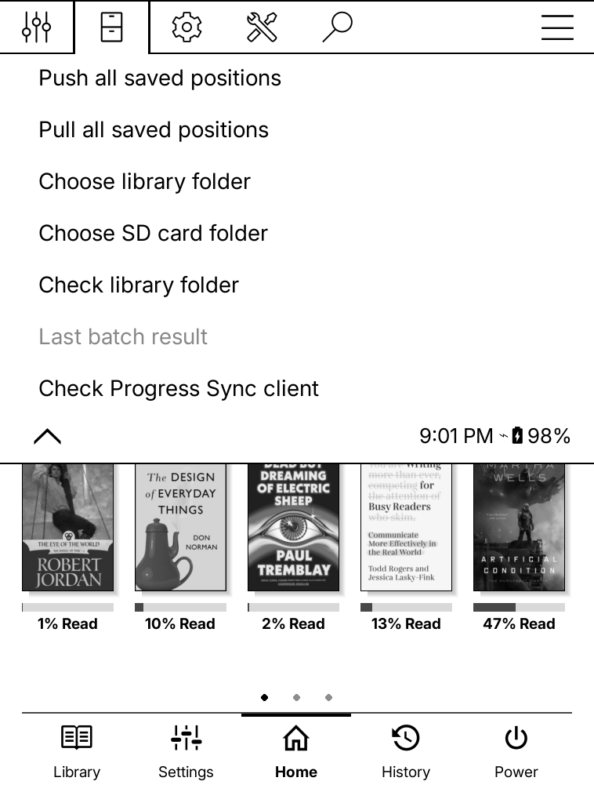

# Bulk Progress Sync

Push or pull saved reading positions for a library folder and its subfolders. The plugin uses your existing KOReader **Progress sync** account and document matching setting.

This project was inspired by [MarMed/kobatchsync](https://github.com/MarMed/kobatchsync).

## 1. Install on your device

These steps assume KOReader is already installed and working. For initial KOReader setup, follow the official [Kobo guide](https://github.com/koreader/koreader/wiki/Installation-on-Kobo-devices), [Kindle guide](https://github.com/koreader/koreader/wiki/Installation-on-Kindle-devices), or [Android guide](https://github.com/koreader/koreader/wiki/Installation-on-Android-devices).

1. Exit KOReader. On PocketBook, Kobo, or Kindle, connect the device to your computer by USB. On Android, use a file manager or USB file transfer.
2. Open the plugin folder for your device from the table below. Create `plugins` if needed on Android.
3. Move older copies of this plugin outside KOReader's plugin directories. Copy the extracted `bulkprogresssync.koplugin` folder into `plugins`; do not merge it into an older copy. Keep the built-in `kosync.koplugin` folder.
4. Safely eject and disconnect USB if connected, then launch KOReader again.

| Device         | Plugin folder                                                                                                                          | Device-specific step                                                                                                                                           |
| -------------- | -------------------------------------------------------------------------------------------------------------------------------------- | -------------------------------------------------------------------------------------------------------------------------------------------------------------- |
| **PocketBook** | `applications/koreader/plugins/` on USB storage                                                                                        | Open the `applications` folder on the connected device.                                                                                                        |
| **Kobo**       | `.adds/koreader/plugins/` on USB storage                                                                                               | Enable hidden files on your computer to see `.adds`. Older installations may use `.kobo/koreader/plugins/`; use the folder containing your installed KOReader. |
| **Kindle**     | `koreader/plugins/` at the root of USB storage                                                                                         | Use your existing KOReader launcher after disconnecting. KOReader must already be installed on a compatible, jailbroken Kindle.                                |
| **Android**    | `Internal storage/koreader/plugins/` (usually `/storage/emulated/0/koreader/plugins/`, also accessible as `/sdcard/koreader/plugins/`) | Start KOReader once before installing to create its data folder. Exit it before copying the plugin, and allow storage access when Android requests it.         |

Check that `main.lua` is directly inside `plugins/bulkprogresssync.koplugin/`, without an extra nested folder.

**Ready:** look for **Bulk Progress Sync** in KOReader's file browser menu.

The separate `kobatchsync.koplugin` can stay installed. Its menu is **Batch progress sync**.

Paths follow KOReader's [plugin installation guidance](https://koreader.rocks/user_guide/#L1-plugins), [Kobo installation layout](https://github.com/koreader/koreader/wiki/Installation-on-Kobo-devices), and [Kindle installation layout](https://github.com/koreader/koreader/wiki/Installation-on-Kindle-devices). Android's data-folder and plugin lookup behavior are defined in KOReader's [data storage code](https://github.com/koreader/koreader/blob/master/datastorage.lua) and [plugin loader](https://github.com/koreader/koreader/blob/master/frontend/pluginloader.lua). Custom installations may use a different location.

## 2. Choose and check your library

1. Close any open book to save its position and return to the file browser.
2. Open **Bulk Progress Sync** and choose the folder option for your device from the table below.
3. Long-press your books folder to select it. To select the folder currently displayed, long-press **Long-press here to choose current folder**.
4. Choose **Check library folder**.

| Device         | Choose your library                                                                                                                                                                                              |
| -------------- | ---------------------------------------------------------------------------------------------------------------------------------------------------------------------------------------------------------------- |
| **PocketBook** | Use **Choose SD card folder** for `/mnt/ext2`, or **Choose library folder** for internal storage.                                                                                                                |
| **Kobo**       | Use **Choose library folder** and select the folder containing your KOReader books on onboard storage.                                                                                                           |
| **Kindle**     | Use **Choose library folder** and select `documents` or your own book folder on USB storage.                                                                                                                     |
| **Android**    | Use **Choose library folder** and select an accessible folder, such as `Books` in internal storage. For an SD card, grant the storage access Android requests; if KOReader cannot open it, use internal storage. |

**Choose SD card folder** is a PocketBook-only shortcut. Kobo, Kindle, and Android use **Choose library folder**.

**Checked:** the result shows the selected path, book count, and scan results. This check does not contact the server or save progress.

Scans skip hidden entries, links outside the selected library, KOReader `.sdr` folders, and unsupported files.

This PocketBook screenshot shows the SD card shortcut. Its older **Last batch result** label is now **Last bulk result**.

## 3. Sync your positions

**Before confirming:** either direction can replace a newer position at the destination. Choose the device or server whose positions you want to keep.

1. Connect to Wi-Fi.
2. In the file browser, open **Bulk Progress Sync** and choose a direction from the table below.
3. Check the library folder and server in the confirmation dialog, then confirm.
4. Read the results. They close after **12 seconds**; open **Last bulk result** to view them again before restarting KOReader.

| Choose                       | What happens                                                                                                                                            |
| ---------------------------- | ------------------------------------------------------------------------------------------------------------------------------------------------------- |
| **Push all saved positions** | Sends valid saved local positions, including updates to existing server progress. Books missing a saved position or percentage are reported separately. |
| **Pull all saved positions** | Applies matching server positions to local books, including unopened books. Existing annotations are kept.                                              |

Progress Sync transfers reading positions. Book files must already be present on both devices. For one open book, use KOReader's built-in **Progress sync** menu.

### Confirm, watch, and review

**Confirm:** check the destination server and selected folder before pushing.

**Watch:** the progress dialog shows the current book and a Cancel button.

**Review:** the result lists accepted positions, skipped books, and requests with book details.

### Stop a sync

Press **Cancel** in the progress dialog. It becomes available shortly after the dialog opens to prevent accidental cancellation.

Completed changes stay applied. An upload already sent may still take effect. If KOReader cannot start a background worker, the screen may pause until the current request finishes.

### Understand matching results

- **Filename matching:** two files with the same name in the selected library are reported as ambiguous.
- **Content matching:** duplicate local copies with conflicting saved positions are skipped on push.

## Optional: send book details to CrossPoint Sync

1. Open a book and set **Progress sync → Custom sync server** to `https://sync.crosspointreader.com`.
2. Turn on **Send document metadata**.
3. Close the book and run **Bulk Progress Sync → Push all saved positions** from the file browser.

Bulk pushes respect the metadata switch. When enabled, they send the filename and any saved title and author. Results show the server that accepted the progress and the number of requests that included book details. CrossPoint's dashboard controls how those records appear.

For any custom server, use a trusted HTTPS URL that answers directly. The plugin does not follow redirects with account credentials.

## Fix a failed single-book push

1. Return to the file browser and choose **Bulk Progress Sync → Check Progress Sync client**.
2. Check that the client path comes from `kosync.koplugin/KOSyncClient.lua`.
3. If another folder appears, move that older copy outside KOReader's plugin search folders and restart KOReader.

The client check reads the module path without syncing anything.

## Testing status

The bulk workflow was tested under LuaJIT with simulated KOReader storage, widgets, and server responses. Live sync and e-ink repaint still need testing on a device.

## AI-use disclaimer

AI tools have assisted with changes to this plugin and its documentation. AI-assisted work can contain mistakes; it does not establish device compatibility or replace testing on hardware. Check the testing status above and back up your KOReader settings before using bulk sync.
